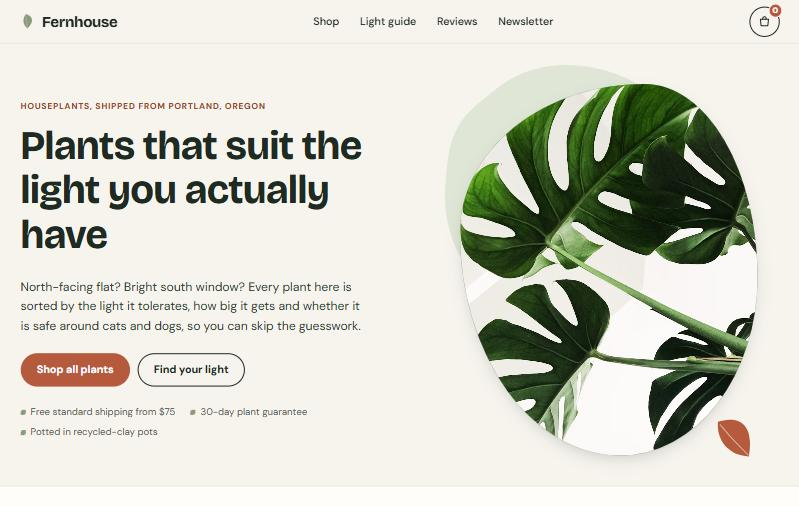
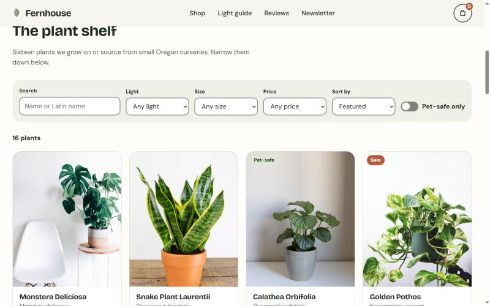
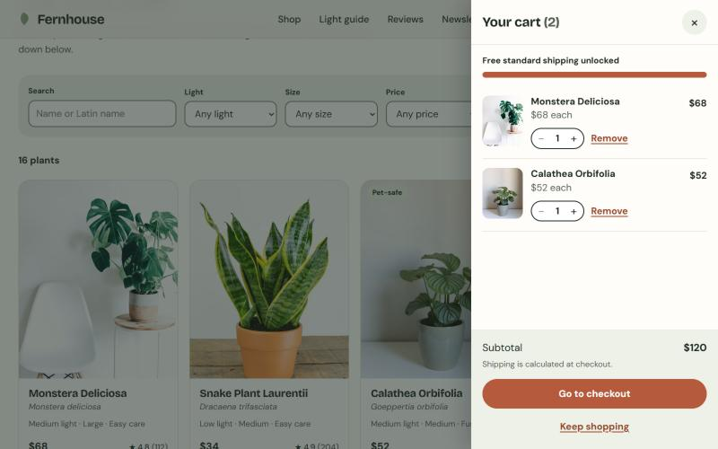
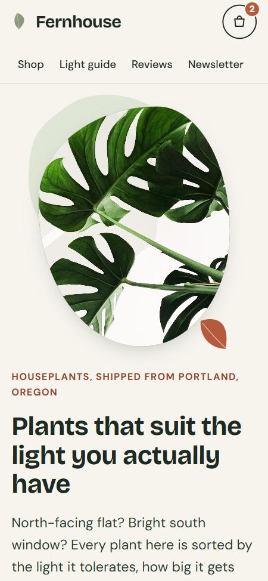

# Fernhouse Plant Co.: React e-commerce storefront

A complete online shop for a fictional Portland houseplant store. Shoppers filter plants by the light they actually have, add them to a cart that remembers them, and check out through a validated demo checkout.

**Live demo:** https://ex-vigilante.github.io/fernhouse-plant-shop/



| Catalog with live filters | Cart drawer | Phone |
|---|---|---|
|  |  |  |

## Features

- **Live filtering and sorting:** search by common or Latin name, plus filters for light level, size, price and pet-safe, and sort options. Results update instantly, and filters are saved in the URL so a filtered view can be shared.
- **Quick view:** an accessible product dialog with care notes and a quantity picker limited to stock.
- **Cart drawer:** change quantities, remove items, see the subtotal and a free-shipping progress bar. Saved in localStorage, so the cart survives a reload.
- **Stock-aware buttons:** a product can't be added beyond stock ("Max in cart"), and sold-out items are disabled.
- **Checkout:** contact and shipping form with inline validation (email, US state, ZIP, phone), three delivery options that update the total, and an order confirmation with an order number. Demo only: no payment is taken.
- **Light guide:** the "Find your light" cards jump straight to filtered results.
- **Accessibility:** focus-trapped dialogs (Esc closes them and focus returns where it was), screen-reader announcements for the cart and results, skip link, WCAG AA contrast, full keyboard use.
- **Polish:** micro-animations that switch off for users who prefer reduced motion, fixed image ratios so the page doesn't jump while loading, and a one-column layout on small phones.

## Tech stack

- React 18 + Vite 6
- Plain CSS (custom properties, grid)
- Google Fonts: Bricolage Grotesque + DM Sans
- GitHub Actions deploys to GitHub Pages

## Run locally

Needs [Node.js](https://nodejs.org) 18 or newer. In PowerShell:

```powershell
npm install
npm run dev
```

Open the address Vite prints (it ends in `/fernhouse-plant-shop/`). To test the production build:

```powershell
npm run build
npm run preview
```

## Deploy

Every push to `main` runs `.github/workflows/deploy.yml`, which builds the site and publishes it to GitHub Pages. In the repo, set **Settings → Pages → Source** to **GitHub Actions**. If you rename the repo, update `base` in `vite.config.js`.

## Notes

Fernhouse is a fictional store made for a portfolio. Reviews are labelled as samples and checkout never asks for card details. Photos are from [Unsplash](https://unsplash.com).
